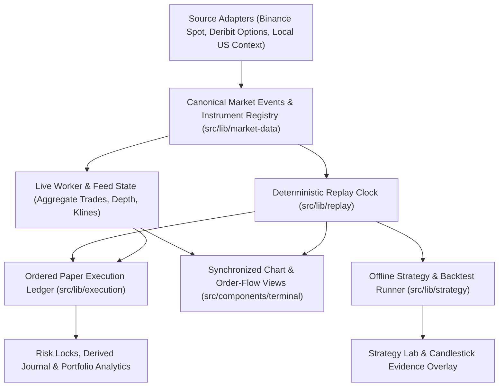

# BTC Derivatives Terminal — System Architecture (`UX20`)

**Source Baseline:** `main` (`f026c1a521cf29caa426f47952ed659db022fcf5` / `7ab2f19d17b0997a8ae5d15c892195e60f22fa5f`)  
**Master Plan Reference:** `BTC_TERMINAL_IMPLEMENTATION_MASTER_PLAN_2026-11-09_1808_EAT.md`  
**Master Plan SHA-256:** `58468A3621BB76A59849FD7D1607EB31E5610108BC8EFAEC3467E56B95E61E0E`  
**Execution Policy:** 100% Simulated / Paper-Only · $0 Incremental Spend · Fail-Closed Data Provenance

---

## 1. High-Level Data & Execution Topology

---

## 2. Domain Boundaries & Ownership

| Layer / Directory | Responsibility | Key Invariants |
| --- | --- | --- |
| `src/lib/market-data/` | Canonical event schemas, versioned instrument registry (`BTCUSDT`, `BTC-USD`, `BTC-DERIBIT-OPT`), unit normalization, timestamp validation, and exception ledger. | Quote currency, multiplier, precision, source mode, and event/receive/release times are explicit. Unknown values stay `null` / `UNAVAILABLE`. |
| `src/lib/deribit/` & `src/app/api/deribit/` | Options chain normalization, exact expiry and cumulative DTE filtering, fail-closed upstream handling. | No synthetic `$69,000` spot or `50%` IV in `LIVE` mode. Upstream errors return typed degraded/unavailable status rather than silent demo substitution. |
| `src/lib/indicators/` & `src/lib/orderflow/` | Pure Volume Profile (bar-approximated vs. trade-derived), AVWAP prefix sums, gap-safe true-flow CVD, footprint tiers, diagonal/stacked imbalances, absorption/acceptance, and Jev deterministic evaluation. | Production Volume Profile lives in `src/lib/indicators/volume-profile.ts`. Trade-derived metrics require executed trades with aggressor side. |
| `src/lib/replay/` | Deterministic Replay Clock (`ReplayClockEngine`) controlling `HISTORICAL_PREVIEW` vs. `DETERMINISTIC_REPLAY` cutoff, cursor, play/pause/seek, and run hash. | Future events beyond the replay cursor are strictly withheld from chart series, indicators, options snapshots, and strategy evaluators. |
| `src/lib/execution/` | Ordered Paper Execution Ledger (`PaperExecutionLedger`), §6.3 paper sizing, 0.25% per-trade risk cap, 1.5% weekly equity-loss lock, derived journal, and §8.1 Portfolio Analytics. | Live-feed paper, replay paper, and backtest runs have isolated account IDs and namespaces. Research runs never mutate paper accounts. |
| `src/lib/strategy/` | Deterministic `NY_VALUE_RETEST_V1` evaluator (§6.1–6.4), local backtest runner (`STRAT-02`), §6.5 research/operational gates, and candlestick evidence projection (`EVIDENCE-06`). | Same snapshot and config always produce identical setup ID, decision, quantity, reason codes, and evidence markers. |
| `src/components/terminal/` | Minimalist institutional chart shell (`CalmMarketTerminal`), `MarketStructureChart`, 3-tier Footprint, 2D Strike × Expiry Options Matrix, Paper Desk (`RiskTerminal`), and `StrategyLabPanel`. | Incremental `series.update` for same-bar ticks, synchronous `useMemo` drawing projection, and 1:1 timestamp/price synchronization. |
| `src/lib/project-control/` | Schema-validated milestone/task tracking, `.agents/project-control-state.json` checkpoint overlay, and `/project-control` + `/project-control/ux20` dashboards. | Implementation, testing, review, and Architect acceptance are tracked independently. Unreported/subscription spend is labeled `UNKNOWN` / `UNREPORTED`. |
