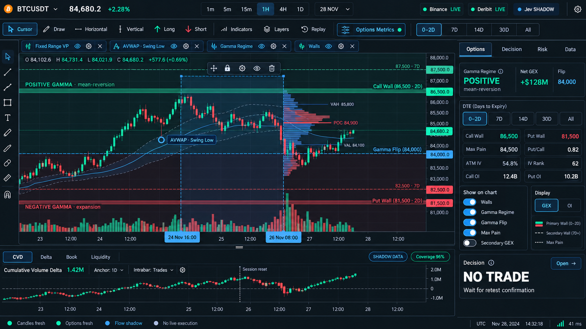

# Bitcoin Derivatives Terminal UI/UX Overhaul Plan

Version: 1.3
Status: UI + AUTHORIZED LIVE MARKET INTEGRATION + DRAWING REPAIR COMPLETE — INDEPENDENT RELEASE REVIEW REQUIRED
Last updated: 2026-10-23
Scope owner: Antigravity / Gemini (Builder & Visual Engine)  
Review owners: Architect (product and derivatives semantics), Codex (type safety, security, and boundary review)

## 1. Purpose

This plan turns the approved chart-first concept into a production UI for the Bitcoin Derivatives Mechanics Terminal. The redesign reduces cognitive load without deleting market information. Important derivatives structure remains visible on the chart, while detailed metrics move into deliberate controls, inspectors, panes, and saved workspaces.

Approved visual direction:



The image is a design target, not evidence that the feature is implemented.

Implementation evidence is available in `/.artifacts/ui-overhaul/` for desktop, mobile, and a live 1664×936 workspace. Binance Spot now supplies the live price/order-flow contract and Deribit remains the live options authority. Demo fixtures remain isolated and explicitly labelled.

### 1.1 Authorized live-data addendum

After the UI-only milestone, the user explicitly requested live, accurate data. That authorization added a narrow UX11 scope: a validated public Binance Spot boundary for candles, ticker, depth, bar-level aggressor delta/CVD, and cumulative Deribit DTE query filtering. It did not authorize changes to derivatives formulas, terrain mathematics, decision engines, Jev semantics, broker connectivity, or execution.

### 1.2 Chart-navigation and Fixed Range VP correction addendum

The user subsequently authorized a focused UX12 repair after reporting that live updates reset the chart viewport and the Fixed Range VP was buggy and limited. UX12 may preserve the chart instance across market updates, bind VP coordinates to chart bars, refine presentation-layer VP binning/value-area behavior, and request bounded Binance intrabars for profile precision. It does not change derivatives, decision, terrain, broker, or execution engines.

### 1.3 Linked lower pane and drawing-object correction addendum

The user authorized UX13 to remove the price-volume histogram, place the CVD/Delta/Book/Liquidity tabs below their pane, synchronize price and time-based order-flow crosshairs, and replace viewport-percentage drawings with real time/price-anchored objects. UX13 includes selection, visible anchors, body and anchor movement, locking, keyboard removal, and reversible deletion. It does not add indicators, alter market calculations, or introduce execution behavior.

## 2. Hard Scope Boundary

UX0–UX10 and UX13 are UI/UX only. UX11 and UX12 are limited to the public market-data boundaries and chart/VP repairs described above.

### Allowed

- Reorganize existing information and controls.
- Add chart, panel, tab, drawer, popover, command-palette, and workspace interactions.
- Add UI-only packages after a compatibility review.
- Add presentation adapters that consume existing typed data without changing its meaning.
- Add local, versioned workspace preferences.
- Add frontend tests, accessibility tests, browser tests, and visual snapshots.
- Add explicit `LIVE`, `DELAYED`, `DEMO`, `SHADOW`, `STALE`, and `UNAVAILABLE` presentation states.

### Forbidden

- No changes to Deribit normalization or derivatives definitions; UX11 may validate and filter the existing normalized chain by an explicit DTE query.
- No edits to `src/lib/quant/`.
- No edits to `src/lib/terrain/` or its formulas/contracts.
- No persistent collector, signal, decision engine, or execution engine. UX11 may expose transient public Binance market snapshots and WebSocket updates.
- No changes to GEX, gamma flip, wall, max-pain, Vanna, Charm, IV, OI, CVD, or VWAP mathematics. UX12 may refine the presentation-layer Volume Profile using bounded Binance intrabars and TradingView's documented POC/value-area rules; it must not alter options-wall calculations.
- No broker integration, order entry, one-click trading, or live execution.
- No synthetic value may be presented as live.
- No UI may convert missing data to zero.

If a requested visualization has no existing frontend-consumable data, its production state must be `UNAVAILABLE`. Fixtures are permitted only in tests and isolated visual-development stories, where they must be labelled `FIXTURE` or `DEMO`.

## 3. Product Outcome

The default experience should answer four questions in order:

1. **Where is price relative to important options structure?**
2. **What gamma regime is active?**
3. **Is order flow confirming or contradicting the location?**
4. **What evidence is available, stale, shadowed, or missing?**

The terminal must provide a clear glance state in under five seconds while retaining detailed inspection paths for every existing metric and workspace.

## 4. UX Principles

1. **Chart first** — price and market structure receive the largest visual area.
2. **Progressive disclosure** — detail is one interaction away, not permanently expanded.
3. **No silent degradation** — unavailable, stale, demo, and shadow data remain visible as states.
4. **Direct manipulation** — chart objects are selected and adjusted on the chart.
5. **Context preservation** — changing a symbol, DTE, strike, or workspace updates linked panels consistently.
6. **Reversible customization** — layouts, panes, studies, and drawings can be saved, restored, reset, locked, and hidden.
7. **Minimal chromatic vocabulary** — color communicates market semantics and status, not decoration.
8. **Keyboard parity** — every major mouse workflow has a keyboard-accessible equivalent.
9. **No execution ambiguity** — the interface remains an analysis terminal and always shows `NO LIVE EXECUTION`.

## 5. Target Information Architecture

```text
TerminalShell
├── CommandBar
│   ├── Symbol and spot context
│   ├── Timeframe and expiry/DTE filters
│   ├── Options Metrics toggle
│   ├── Workspace/layout selector
│   └── Data-health badges
├── WorkspaceViewport
│   ├── ChartToolbar
│   ├── DrawingToolbar
│   ├── ActiveStudyLegend
│   ├── PriceChartWorkspace
│   │   ├── Walls and options levels
│   │   ├── Gamma regime shading
│   │   ├── Fixed Range Volume Profile
│   │   ├── Anchored VWAP
│   │   └── User drawings and positions
│   └── StudyPaneStack
│       ├── CVD
│       ├── Delta
│       ├── Book imbalance
│       └── Liquidity
├── InspectorRail
│   ├── Options
│   ├── Decision
│   ├── Risk
│   └── Data / health
├── AlternateWorkspaces
│   ├── 3D Surface Map
│   ├── GEX Analysis
│   ├── Vanna
│   ├── Charm
│   └── Open Interest
└── StatusBar
```

The existing 3D terrain and analytical workspaces are retained. They become named workspaces available through the command palette, workspace switcher, and keyboard shortcuts; they are not forced into the default chart view.

## 6. Core Feature Specification

### 6.1 Command bar and navigation

- One compact top bar for symbol, spot, timeframe, expiry, DTE, workspace, and health.
- `Ctrl+K` command palette for symbols, workspaces, studies, layers, and settings.
- Favorite timeframes, studies, and tools.
- Saved workspace selector with `Save`, `Save as`, `Restore`, `Rename`, and `Reset`.
- A compact collapsible navigation rail replaces a permanently wide menu.
- No essential metric should require navigating to another browser page.

### 6.2 Options Metrics control

The `Options Metrics` button toggles the right-side Options inspector.

Required groups:

- Gamma regime, Net GEX, and Gamma Flip.
- Primary and secondary Call/Put Walls.
- Max Pain.
- Put/Call ratio.
- ATM IV and IV rank when present in the current contract.
- Call and Put OI.
- GEX/OI display selector.
- DTE filters: `0–2D`, `7D`, `14D`, `30D`, and `All`.
- Independent `Show on chart` toggles.

Changing a filter may only select or hide existing data. It must not recalculate backend values in the browser.

### 6.3 Walls and options levels

- Primary walls render as restrained horizontal zones.
- Secondary walls render as lower-opacity dashed levels.
- Every label includes type, strike, and DTE/expiry context.
- Importance is communicated through thickness, opacity, and label priority.
- Labels use collision avoidance and group when several levels occupy the same price region.
- Hover or focus reveals the source, timestamp, expiry breadth, and exact value when those fields exist.
- Clicking a level selects the corresponding item in the Options inspector and linked analytical workspace.

### 6.4 Gamma regime shading

- Gamma Flip is a visible, labelled boundary.
- Positive and negative regime regions use very low-opacity semantic shading behind candles.
- Shading follows the existing engine contract; the UI must not infer regime solely from screen position.
- Users can toggle shading, labels, and boundary independently.
- Opacity is adjustable and defaults to a level that preserves candle and grid legibility.
- Transitional or uncertain states use neutral shading and explicit text rather than forced green/red classification.

### 6.5 Fixed Range Volume Profile

- Drawn from a user-selected start coordinate to an end coordinate.
- Histogram stays inside the selected time range and attaches to the chosen range edge.
- Start and end handles snap to valid chart timestamps.
- The body can be dragged to move the whole range.
- POC, VAH, VAL, value-area shading, row direction, width, opacity, and labels remain configurable.
- Selected state exposes Move, Lock, Settings, Hide, Duplicate, and Delete.
- Multiple instances are permitted and named automatically.
- A distinct Visible Range mode may be offered, but it must not replace Fixed Range behavior.

### 6.6 Anchored VWAP

- Anchored VWAP begins at the selected candle and renders only to its right.
- The anchor is a visible, keyboard-focusable, draggable handle.
- Dragging the anchor recalculates presentation using the existing approved calculation path; this UI milestone does not alter the formula.
- Users can lock, hide, duplicate, rename, reset, and delete an instance.
- Session, week, month, and manual anchors remain available when supported by the existing contract.
- Optional deviation bands are controlled per instance.
- Multiple named instances are supported in the UI model.

### 6.7 CVD and order-flow panes

- CVD occupies a resizable lower pane with a synchronized time axis and crosshair.
- Default CVD view uses cumulative OHLC candles with wicks, a zero line, anchor label, and reset dividers.
- Header exposes anchor period, source/intrabar context, coverage, freshness, and settings.
- Tabs provide CVD, Delta, Book, and Liquidity views.
- Divergence markers are optional and hidden by default.
- `SHADOW`, `STALE`, and `UNAVAILABLE` states are prominent.
- No order-flow value may appear in production unless supplied by an existing authorized data contract.

### 6.8 Layer and study management

- One Layers manager owns chart overlays, studies, drawings, and analytical levels.
- Active items also appear as compact chips above the chart.
- Each compatible item supports show/hide, settings, remove, reorder, and pane placement.
- Visual order is explicit.
- Favorites appear first in tool menus.
- `Hide all`, `Lock all drawings`, and `Restore previous visibility` are provided.

### 6.9 Inspector rail

- Tabs: Options, Decision, Risk, Data.
- Only one tab is expanded at a time.
- Rail is resizable, collapsible, and restorable.
- Selecting a chart object opens the relevant inspector section.
- Closing the rail returns width to the chart without disabling overlays.
- Existing detailed tables remain available through Data or named analytical workspaces.

### 6.10 Workspaces, linking, and persistence

- Initial presets: `Market Structure`, `Options`, `Order Flow`, `3D Surface`, and `Review`.
- Panels in the same link group share symbol, selected strike, expiry/DTE, and crosshair where compatible.
- Users may save, duplicate, rename, restore, and reset layouts.
- Workspace state uses a versioned local schema and migration path.
- A failed migration resets only UI preferences; it must not affect market data.

### 6.11 Responsive behavior

- Desktop: chart plus optional inspector and lower pane.
- Tablet: collapsible inspector drawer and reduced drawing toolbar.
- Mobile: chart-first, compact top bar, bottom navigation, and one bottom sheet at a time.
- The full Risk or Data panel must never be permanently stacked beneath the chart.
- No accidental horizontal overflow at 390 px.

### 6.12 Accessibility

- Semantic buttons, tabs, dialogs, menus, sliders, and tooltips.
- Visible focus state on every interactive control and chart object handle.
- Keyboard operation for pane resizing, layer ordering, drawing selection, and inspectors.
- Non-color encoding for regime, walls, status, and positive/negative states.
- Minimum 44 px touch targets on mobile; compact desktop controls may be smaller when keyboard accessible.
- Screen-reader summaries for chart state, selected object, and data health.
- Respect `prefers-reduced-motion`.

## 7. Implementation Milestones

| Milestone | Scope | Exit evidence |
| --- | --- | --- |
| UX0 | Research, plan, feature sourcing, approved visual baseline | Four approved planning documents and stored preview |
| UX1 | Design tokens, accessible primitives, shell, command bar, collapsible navigation | Desktop/tablet/mobile shell snapshots; keyboard traversal |
| UX2 | Resizable chart workspace, inspector rail, study pane stack, workspace state schema | Resize/collapse/persist tests; no data or engine changes |
| UX3 | Options Metrics inspector, DTE filters, walls, gamma flip, regime shading | Level-selection tests; collision checks; provenance visible |
| UX4 | Layer manager, active-study chips, object selection model | Reorder/hide/lock/restore tests |
| UX5 | Fixed Range VP and AVWAP direct manipulation | Mouse and keyboard interaction tests; persistence and replay-safe UI state |
| UX6 | CVD/Delta/Book/Liquidity presentation surfaces | Candle/reset rendering tests; explicit unavailable/stale states |
| UX7 | Saved layouts, command palette, favorites, link groups, 3D/analytics workspace integration | Save/restore/migrate/link tests |
| UX8 | Responsive, accessibility, performance, and visual polish | Playwright matrix, axe checks, performance evidence |
| UX9 | Independent review and release handoff | Architect acceptance; Gemini handoff; zero backend diff |

## 8. Milestone Detail

### UX1 — Foundation

Deliver:

- UI tokens for surface, border, text, semantic status, spacing, and z-index.
- Accessible Tabs, Dialog, Popover, Dropdown, Tooltip, Slider, Switch, and Command Palette foundations.
- Compact command bar and collapsible navigation.
- Default chart-first responsive shell.

Acceptance:

- No gradients or ornamental glow.
- No more than one dominant accent color outside market/status semantics.
- All controls reachable by keyboard.
- Existing workspaces remain reachable.

### UX2 — Workspace mechanics

Deliver:

- Horizontal price/inspector split.
- Vertical chart/study split.
- Collapse and maximize behaviors.
- Versioned local layout persistence.
- Named workspace presets.

Acceptance:

- Pane changes survive reload.
- Reset returns to the approved default layout.
- Layout corruption falls back safely.
- Chart remains at least 70% of the default desktop analysis area.

### UX3 — Options structure

Deliver:

- Options Metrics inspector.
- DTE selector.
- Wall zones and secondary levels.
- Gamma Flip and regime shading.
- Max Pain and GEX/OI display controls.

Acceptance:

- Every visible overlay can be traced to a displayed source/status.
- Primary versus secondary levels are distinguishable without relying only on color.
- Dense labels do not cover the active candle area.

### UX4 — Layers and studies

Deliver:

- Unified object tree.
- Active study chips.
- Favorites and recent tools.
- Hide/lock/reorder operations.

Acceptance:

- One consistent control path for all chart layers.
- Hidden objects retain settings.
- Removing an object requires a reversible confirmation/undo path.

### UX5 — VP and AVWAP

Deliver:

- Fixed Range VP drawing and editing experience.
- AVWAP anchor selection and editing experience.
- Multiple UI instances and object-specific settings.

Acceptance:

- VP remains inside the selected range.
- AVWAP never renders to the left of its anchor.
- Selection handles do not affect chart autoscaling.
- Drawing interactions work with mouse, touch where supported, and keyboard.

### UX6 — Order-flow presentation

Deliver:

- CVD cumulative-candle renderer.
- Anchor/reset markers.
- Coverage and health badges.
- Delta, Book, and Liquidity placeholder states.

Acceptance:

- Missing data displays `UNAVAILABLE`, never zero.
- Fixtures never appear in production mode.
- CVD and price share time navigation without future-data leakage in replay-capable contexts.

### UX7 — Professional workflow

Deliver:

- Command palette.
- Saved layouts and templates.
- Link groups.
- Favorite tools and timeframes.
- 3D terrain and ECharts analysis views integrated as preserved workspaces.

Acceptance:

- A user can reach any principal workspace in two actions or one shortcut.
- Symbol/strike/DTE selection propagates only to panels in the same link group.
- Workspace restore is deterministic.

### UX8 — Quality pass

Deliver:

- Responsive layouts at 390×844, 768×1024, 1366×768, 1440×900, and 1920×1080.
- Accessibility and reduced-motion behavior.
- Stable screenshot baselines.
- Render and interaction performance evidence.

Acceptance:

- No unintended horizontal overflow.
- No clipped menus or unreachable controls.
- No overlapping labels in the default layout.
- Chart pan/zoom and handle dragging remain responsive under representative overlay load.

## 9. Proposed Frontend Structure

```text
src/components/terminal/
  TerminalShell.tsx
  CommandBar.tsx
  CompactNavigation.tsx
  StatusBar.tsx

src/components/chart/
  PriceChart.tsx
  ChartToolbar.tsx
  DrawingToolbar.tsx
  ActiveStudyLegend.tsx
  LayerManager.tsx
  overlays/
    WallOverlay.ts
    GammaRegimeOverlay.ts
    GammaFlipOverlay.ts
    FixedRangeVolumeProfile.ts
    AnchoredVwap.ts
  panes/
    CvdPane.tsx
    DeltaPane.tsx
    BookPane.tsx
    LiquidityPane.tsx

src/components/inspector/
  InspectorRail.tsx
  OptionsInspector.tsx
  DecisionInspector.tsx
  RiskInspector.tsx
  DataHealthInspector.tsx

src/components/workspace/
  WorkspaceViewport.tsx
  WorkspaceManager.tsx
  WorkspacePresetMenu.tsx

src/lib/ui/
  workspace-schema.ts
  study-registry.ts
  layer-registry.ts
  keyboard-shortcuts.ts
  presentation-adapters.ts
```

This is a target organization, not authorization to move backend-owned files.

## 10. Testing and Verification

### Unit and component tests

- Workspace schema validation and migrations.
- Layer ordering and visibility.
- DTE filtering as a presentation operation.
- Wall-label prioritization and collision grouping.
- Regime-state presentation for positive, negative, transitional, stale, and unavailable states.
- Fixed Range VP and AVWAP selection-state reducers.
- CVD candle rendering from an already-supplied UI series.

### Browser workflows

- Open/close Options Metrics without losing active overlays.
- Change DTE filter and verify chart/inspector consistency.
- Create, move, resize, lock, hide, duplicate, and delete VP/AVWAP objects.
- Resize and collapse inspector and CVD panes.
- Save, reload, restore, and reset a workspace.
- Navigate by keyboard and command palette.
- Verify unavailable and stale data states.

### Visual regression

- Default chart-first layout.
- Options inspector open.
- CVD pane open.
- Selected VP.
- Selected AVWAP.
- Positive, negative, and transitional gamma regimes.
- Dense wall labels.
- 3D Surface workspace.
- Mobile bottom-sheet states.

### Required repository gates

- `npx vitest run`
- `npm run lint`
- `npm run build`
- Playwright functional and visual suites after they are introduced.
- Git diff audit proving no backend/engine files changed.

## 11. Performance Budgets

- Initial terminal shell should become interactive within 2 seconds on the agreed test machine and cached development dataset.
- Normal chart pan, zoom, crosshair, and drag interactions target 60 fps; sustained behavior below 45 fps is a release blocker.
- Pointer feedback for selectable chart objects should appear within 50 ms.
- Inspector/tab switches should not recreate the chart instance.
- Hidden workspaces must not run animation loops.
- The 3D workspace may load lazily and must stop rendering when not visible.
- Label collision and overlay hit-testing must operate on visible ranges only.

## 12. Risks and Mitigations

| Risk | Mitigation |
| --- | --- |
| UI promises live CVD without a data contract | Render `UNAVAILABLE`; do not create a frontend calculation |
| Dual chart libraries create inconsistent interactions | Assign clear ownership: Lightweight Charts for price/time studies; ECharts for analytical plots; Three.js for terrain |
| Too many visible options levels recreate clutter | DTE filters, priority tiers, label grouping, and layer presets |
| Saved layouts break after schema changes | Versioned Zod schema, migrations, and safe reset |
| Canvas controls are inaccessible | DOM control layer, keyboard model, focus indicators, and textual summaries |
| 3D rendering consumes resources while hidden | Lazy load and pause/dispose inactive render loops |
| Proprietary-platform imitation creates IP risk | Borrow interaction concepts only; no copied assets, code, branding, or pixel-identical layouts |

## 13. Definition of Done

The milestone is complete only when:

- All existing user-facing information remains reachable within one interaction or a named workspace.
- Walls, Gamma Flip, and gamma regime are legible on the chart.
- Options Metrics supports DTE filtering and overlay toggles.
- Fixed Range VP and AVWAP are directly manipulable.
- CVD uses cumulative candles and explicit anchor/reset semantics when valid data is available.
- Detailed panels no longer compete simultaneously for attention.
- Layouts persist and restore safely.
- Mobile and desktop acceptance matrices pass.
- Data provenance and unavailable states are explicit.
- Existing 3D, GEX, Vanna, Charm, and OI workspaces remain accessible.
- No backend, API, Deribit, quant, or terrain-engine file is changed.
- No live execution capability is added.
