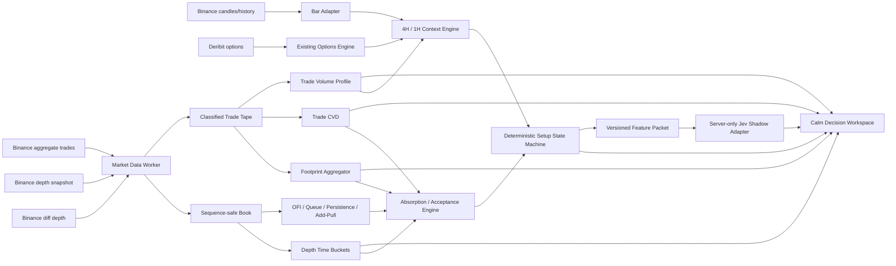

# UX16 Institutional Activity Map and Calm Decision Workspace

Version: 1.0
Status: READY FOR IMPLEMENTATION — staged delivery and review gates required
Created: 2026-10-25
Baseline branch: `codex/ux15-assembled`
Baseline commit: `eb957928418995b7802c5bf910ad2590d87021ba`
Primary workflow: BTC 4H context, 1H setup, 1m/5m execution confirmation
Safety boundary: analysis and paper evaluation only; `NO LIVE EXECUTION`

## 1. Purpose

UX16 replaces the current noisy liquidity presentation with a calm, evidence-ranked Institutional Activity Map. The terminal must help the user locate potential large-participant activity without claiming that public market data can identify an institution with certainty.

The finished workspace must answer, in this order:

1. Where is price relative to an important decision level?
2. Is meaningful passive liquidity present, persistent, replenishing, or being pulled?
3. Are aggressive buyers or sellers active at that level?
4. Is aggressive flow moving price, being accepted, or being absorbed?
5. Does true trade-based CVD confirm or diverge from price?
6. Do volume profile, AVWAP, higher-timeframe structure, gamma regime, or options levels strengthen the location?
7. Is the evidence sufficient for `WATCH`, `CONFIRMING`, `A_GRADE`, `INVALIDATED`, or `AVOID`?
8. What exact event confirms the setup, and what exact price invalidates it?

This plan is prescriptive. Codex and Antigravity must implement it in the stated sequence, use the specified ownership boundaries, and stop at every checkpoint for review. An agent must not silently replace a formula, data source, state name, visual priority, or acceptance criterion.

## 2. Product Thesis

The product is not an indicator collection. It is an evidence-reduction system.

Raw market events are converted into deterministic observations. Observations are related to structural locations. Only qualified relationships become setup evidence. The interface then reveals the smallest amount of information needed for the user's current task.

The intended progression is:

```text
validated events
    -> normalized book and trade tape
    -> price/time aggregates
    -> deterministic microstructure observations
    -> structural confluence
    -> setup state machine
    -> quiet visual presentation
    -> optional Jev shadow explanation
```

The terminal must never reverse this progression. Jev must not interpret raw pixels, invent unavailable evidence, or create a setup that the deterministic engine did not produce.

## 3. Non-Negotiable Principles

1. **No fabricated market data.** Missing history remains missing and visibly bounded.
2. **No institutional certainty claim.** Use `probable absorption`, `persistent liquidity`, `possible replenishment`, and `large-participant behavior likely`.
3. **No raw-book-only signal.** Displayed liquidity is not enough; execution and price response are required for absorption.
4. **No AI-only decision.** Jev explains a versioned deterministic packet and can abstain. It cannot create or override a grade.
5. **No live execution.** No exchange credentials, broker routes, order placement, or live account actions are introduced.
6. **No silent approximation.** Every derived value includes provenance, coverage, freshness, and approximation status.
7. **No signal conflation.** Depth, executed volume, CVD, volume profile, AVWAP, and options structure remain distinct inputs.
8. **No proprietary cloning.** Use public documentation and permissively licensed open-source patterns. Do not copy commercial code, assets, private endpoints, or branding.
9. **No animation-led design.** Motion is used only for local feedback, lasts no more than 200 ms, and respects reduced-motion preferences.
10. **No unlimited visual density.** Default mode has a strict attention budget defined in this document.

## 4. Current Baseline and Verified Gaps

### 4.1 What UX15 already provides

- Live Binance Spot candles and bar-level taker-buy/taker-sell delta.
- Up to 10,000 chart candles per supported interval.
- Sequence-validated Binance Spot depth reconstruction.
- A bounded, session-local depth-frame buffer in a Web Worker.
- A canvas liquidity overlay with live/stale/gap/offline provenance.
- Deribit options structure and key levels.
- CVD and Delta lower studies.
- Fixed Range VP controls and AVWAP controls.
- Fibonacci, chart drawings, Long/Short planning objects, and deterministic risk calculations.
- A collapsible lower study pane.
- `NO LIVE EXECUTION` behavior.

### 4.2 What is currently inadequate

- `LiquidityHeatmapOverlay.tsx` maps retained frame order into a strip on the right side instead of mapping frame timestamps to the chart time axis.
- The current overlay selects a limited number of top levels independently per frame, creating unstable stripes and rank flicker.
- Additive saturated bid/ask colors visually overpower price, options structure, and the user's actual decision levels.
- The liquidity worker receives depth updates but no synchronized aggregate-trade stream.
- The terminal cannot yet compute a real trade-at-price footprint.
- Current CVD is bar precision. It does not preserve trade-by-trade price location or intrabar delta path.
- Current Fixed Range VP distributes candle volume across the candle range; it is an approximation, not a trade-built volume-at-price profile.
- Heatmap history is lost when the browser session ends.
- The repository has a Jev placeholder but no Jev server adapter, validated response contract, or frontend integration.
- Binance Spot is the only implemented microstructure venue. It cannot represent the entire BTC spot/perpetual market.

### 4.3 Consequence

The existing heatmap is a useful depth-transport proof, but it must not be cosmetically restyled and presented as institutional-activity detection. UX16 must replace its projection, add executed-trade ingestion, and introduce evidence gates.

## 5. Scope

### 5.1 In scope

- Calm Analytical Instrument design system.
- Context, Flow, and Setup workspace modes.
- Timestamp-aligned historical liquidity surface.
- Aggregate-trade ingestion and replay.
- True trade-at-price footprint cells.
- True trade-based CVD and delta.
- Trade-built volume profile for captured coverage.
- Diagonal and stacked imbalance.
- Order-flow imbalance, queue imbalance, liquidity persistence, add/pull events, and probable replenishment.
- Deterministic absorption and acceptance observations.
- Confluence with AVWAP, VP, higher-timeframe structure, gamma regime, gamma flip, options walls, and DTE selection.
- Deterministic setup state machine and evidence packet.
- Jev shadow explanation after deterministic acceptance.
- Replay, calibration, paper evaluation, provenance, and observability.
- Feature flags and staged rollout.

### 5.2 Explicitly out of scope

- Live orders, broker accounts, exchange credentials, or automated execution.
- Claims that a specific participant is an institution.
- Guaranteed reversal or entry predictions.
- Native/MBO-quality iceberg detection from Binance MBP data.
- Copying TradingView, Bookmap, ATAS, Sierra Chart, or another platform pixel-for-pixel.
- A permanent DOM, tape, full footprint, heatmap, options panel, and AI panel all visible simultaneously.
- Historical tick reconstruction from OHLCV candles.
- Training a machine-learning trading model during UX16.
- Promoting Jev beyond `SHADOW`.

## 6. Success Criteria

UX16 is complete only when all of the following are true:

1. A new user can identify the active decision zone, current setup state, confirming evidence, conflict, and invalidation within five seconds.
2. The default 1H/4H chart contains no footprint numbers and no full-intensity raw depth carpet.
3. Every heatmap column aligns with an actual timestamp on the chart.
4. Every footprint cell is built from classified trades, never inferred from candle direction.
5. CVD breaks across unfilled capture gaps.
6. A probable absorption event cannot exist without location, aggressive execution, inefficient price progress, and passive-liquidity evidence.
7. An `A_GRADE` event cannot exist if a mandatory data-quality or invalidation gate fails.
8. Options structure can strengthen or weaken location but cannot independently create a setup.
9. Jev can explain, question, or abstain, but cannot change deterministic state.
10. The terminal remains responsive with 10,000 candles, the configured liquidity window, footprint data, and the lower pane active.
11. All signals can be reproduced from a recorded fixture.
12. A user can turn every secondary layer off and recover a clean candlestick chart.

## 7. Terminology and Semantic Contract

| Term | UX16 definition |
| --- | --- |
| Passive liquidity | Resting limit-order quantity visible in the maintained order book |
| Aggressive buy | A trade initiated by a buyer lifting the offer |
| Aggressive sell | A trade initiated by a seller hitting the bid |
| Book imbalance | Difference between resting bid and ask liquidity over a declared price/depth window |
| Order-flow imbalance (OFI) | Net supply/demand change incorporating best-price and best-quantity changes over a time window |
| Footprint imbalance | Diagonal dominance of executed buy or sell volume across adjacent price rows |
| Stacked imbalance | A declared number of adjacent footprint rows dominated by the same aggressor side |
| Persistence | Time-weighted survival of liquidity at a price bucket |
| Pull | Meaningful reduction of resting liquidity not explained by observed execution |
| Replenishment | Resting liquidity returning at a price shortly after executions consume displayed size |
| Probable absorption | Unusually strong aggression with weak price progress and opposing passive-liquidity evidence at a meaningful location |
| Acceptance | Price progresses through a level and remains beyond it with continued aligned flow |
| Exhaustion | Directional price movement continues while executed activity declines materially |
| Decision zone | A bounded price region where one or more validated structural levels cluster |
| Evidence | A deterministic, timestamped observation with source and quality metadata |
| A-grade | All mandatory setup gates satisfied plus the configured number of context enhancers; initially a rule grade, not a win probability |

## 8. Data Authority and Provenance

| Domain | Initial authority | Precision | Required UI label |
| --- | --- | --- | --- |
| Candles | Binance Spot BTCUSDT | Exchange kline | `BINANCE SPOT` |
| Aggregate trades | Binance Spot `btcusdt@aggTrade` | Taker-order aggregates | `SPOT TAPE` |
| Resting depth | Binance Spot diff depth plus REST snapshot | MBP/L2 | `SPOT L2` |
| CVD | Classified aggregate trades | Trade-based after capture boundary | `TAPE CVD` |
| Footprint | Classified aggregate trades by price/time bucket | Trade-based after capture boundary | `TAPE FOOTPRINT` |
| Volume profile | Classified aggregate trades; candle approximation only before boundary | Mixed coverage | `TRADE VP` or `APPROX VP` |
| Options structure | Deribit public options data and existing quant engine | Structural/derived | `DERIBIT OPTIONS` |
| AI explanation | Jev over deterministic packet | Shadow interpretation | `JEV SHADOW` |

Every display contract must include:

- `source`
- `venue`
- `symbol`
- `capturedAt`
- `eventTime`
- `coverageStart`
- `coverageEnd`
- `freshnessMs`
- `sequenceState`
- `gapCount`
- `precision`
- `approximation`
- `schemaVersion`

## 9. Target Architecture



### 9.1 Architectural boundaries

- Networking and high-frequency aggregation stay outside React.
- Raw WebSocket callbacks never call React state for every event.
- The worker is the authority for sequence validity and captured market events.
- Domain calculations are pure functions with deterministic fixtures.
- Rendering receives bounded immutable snapshots.
- The UI never derives trading semantics from pixel position.
- Jev receives a compact deterministic packet, not raw order books or unrestricted application state.

## 10. Repository Structure

The implementation should converge on this structure:

```text
src/
  lib/
    orderflow/
      contracts.ts
      provenance.ts
      trade-classifier.ts
      trade-bucketer.ts
      footprint.ts
      cvd.ts
      volume-profile.ts
      order-flow-imbalance.ts
      liquidity-persistence.ts
      replenishment.ts
      absorption.ts
      decision-zones.ts
      setup-engine.ts
      feature-packet.ts
      replay.ts
      *.test.ts
    binance/
      liquidity-runtime.ts
      liquidity.worker.ts
      use-liquidity-heatmap.ts
      existing sequence-safe depth modules
    intelligence/
      jev-contract.ts
      jev-client.server.ts
      jev-baseline.ts
      jev-rate-limit.server.ts
      *.test.ts
  app/
    api/
      intelligence/jev/route.ts
      orderflow/replay/route.ts          # optional local/research route
  components/
    terminal/
      MarketTerminal.tsx
      MarketStructureChart.tsx
      CalmTerminalToolbar.tsx
      ContextMode.tsx
      FlowMode.tsx
      SetupMode.tsx
      InstitutionalActivityMap.tsx
      LiquiditySurface.tsx
      FootprintSeries.tsx
      OrderFlowMarkers.tsx
      DecisionDock.tsx
      EvidenceList.tsx
      DataIntegrityStrip.tsx
      LowerStudyPane.tsx
      terminal-theme.ts
      *.test.tsx
tests/
  fixtures/orderflow/
  replay/
  ui/
    institutional-activity-map.pw.ts
```

New folders may be adjusted only during the UX16.0 architecture checkpoint. After that checkpoint, moving domain ownership between folders requires Architect approval.

## 11. Core Data Contracts

Codex owns these contracts. Antigravity consumes them without redefining them.

### 11.1 Classified trade

```ts
interface ClassifiedTradeV1 {
  schemaVersion: 1;
  venue: 'BINANCE_SPOT';
  symbol: 'BTCUSDT';
  aggregateTradeId: number;
  firstTradeId: number;
  lastTradeId: number;
  eventTime: number;
  tradeTime: number;
  price: number;
  quantityBtc: number;
  notionalUsd: number;
  aggressor: 'BUY' | 'SELL';
  buyerIsMaker: boolean;
}
```

Classification rule:

- `buyerIsMaker === true` means the buyer rested and the seller aggressed: `SELL`.
- `buyerIsMaker === false` means the buyer aggressed: `BUY`.

Reject non-finite, non-positive, out-of-order, duplicate, or symbol-mismatched events. Deduplicate by venue, symbol, and aggregate trade ID.

### 11.2 Footprint cell and bar

```ts
interface FootprintCellV1 {
  priceLow: number;
  priceHigh: number;
  priceMid: number;
  buyVolumeBtc: number;
  sellVolumeBtc: number;
  buyNotionalUsd: number;
  sellNotionalUsd: number;
  totalNotionalUsd: number;
  deltaNotionalUsd: number;
  tradeCount: number;
  buyImbalance: boolean;
  sellImbalance: boolean;
  imbalanceRatio: number | null;
}

interface FootprintBarV1 {
  openTime: number;
  closeTime: number;
  interval: string;
  priceBucket: number;
  cells: FootprintCellV1[];
  totalNotionalUsd: number;
  deltaNotionalUsd: number;
  pocPrice: number | null;
  minRunningDeltaUsd: number;
  maxRunningDeltaUsd: number;
  coverage: CaptureCoverageV1;
}
```

### 11.3 Depth time bucket

```ts
interface DepthBucketV1 {
  bucketStart: number;
  bucketEnd: number;
  priceLow: number;
  priceHigh: number;
  side: 'BID' | 'ASK';
  meanNotionalUsd: number;
  maxNotionalUsd: number;
  endNotionalUsd: number;
  addedNotionalUsd: number;
  removedNotionalUsd: number;
  executedAgainstUsd: number;
  persistenceMs: number;
  observationCount: number;
  sequenceValid: boolean;
}
```

### 11.4 Evidence

```ts
type EvidenceKind =
  | 'STRUCTURAL_LEVEL'
  | 'PERSISTENT_LIQUIDITY'
  | 'LIQUIDITY_ADD'
  | 'LIQUIDITY_PULL'
  | 'PROBABLE_REPLENISHMENT'
  | 'BUY_IMBALANCE'
  | 'SELL_IMBALANCE'
  | 'STACKED_BUY_IMBALANCE'
  | 'STACKED_SELL_IMBALANCE'
  | 'BULLISH_ABSORPTION'
  | 'BEARISH_ABSORPTION'
  | 'BULLISH_CVD_DIVERGENCE'
  | 'BEARISH_CVD_DIVERGENCE'
  | 'ACCEPTANCE_ABOVE'
  | 'ACCEPTANCE_BELOW'
  | 'DATA_CONFLICT';

interface MarketEvidenceV1 {
  id: string;
  schemaVersion: 1;
  kind: EvidenceKind;
  direction: 'BULLISH' | 'BEARISH' | 'NEUTRAL';
  startTime: number;
  endTime: number | null;
  priceLow: number;
  priceHigh: number;
  strengthPercentile: number;
  confidence: 'LOW' | 'MEDIUM' | 'HIGH';
  reasonCodes: string[];
  sourceRefs: string[];
  quality: CaptureCoverageV1;
  invalidatedAt: number | null;
}
```

### 11.5 Setup assessment

```ts
type SetupState =
  | 'NO_SETUP'
  | 'WATCH_LONG'
  | 'WATCH_SHORT'
  | 'CONFIRMING_LONG'
  | 'CONFIRMING_SHORT'
  | 'A_GRADE_LONG'
  | 'A_GRADE_SHORT'
  | 'INVALIDATED'
  | 'AVOID'
  | 'INSUFFICIENT_DATA';

interface SetupAssessmentV1 {
  schemaVersion: 1;
  state: SetupState;
  asOf: number;
  symbol: 'BTCUSDT';
  contextTimeframes: ['4h', '1h'];
  triggerTimeframe: '1m' | '5m';
  zone: { low: number; high: number; label: string } | null;
  trigger: { description: string; price: number | null } | null;
  invalidation: { description: string; price: number | null } | null;
  mandatoryGates: Record<string, 'PASS' | 'FAIL' | 'MISSING'>;
  enhancers: Record<string, 'ALIGNED' | 'CONFLICTING' | 'UNAVAILABLE'>;
  evidenceIds: string[];
  conflictIds: string[];
  grade: 'A' | 'B' | 'WATCH' | 'NONE';
  dataQuality: CaptureCoverageV1;
  deterministicVersion: string;
}
```

## 12. Calculation Specifications

### 12.1 Price bucketing

- Obtain instrument tick size from the exchange contract or a validated configuration.
- A display row may group multiple ticks, but grouping never changes the instrument's actual tick size.
- Normalize a trade price into a stable integer tick index before calculating its display bucket.
- Avoid floating-point map keys. Use integer tick indexes internally.
- Store the grouping factor with every computed footprint.
- Changing display grouping recomputes presentation aggregates from captured trades; it must not mutate source events.

### 12.2 Footprint aggregation

For every classified trade:

1. Resolve the containing candle interval.
2. Resolve the integer price bucket.
3. Add notional and quantity to `buy` when aggressor is `BUY`.
4. Add notional and quantity to `sell` when aggressor is `SELL`.
5. Increment trade count.
6. Update running candle delta.
7. Preserve coverage boundaries and capture gaps.

For each cell:

```text
delta = aggressiveBuyNotional - aggressiveSellNotional
total = aggressiveBuyNotional + aggressiveSellNotional
deltaPercent = total > 0 ? delta / total : 0
```

### 12.3 Diagonal imbalance

For price-row index `i`:

```text
buyRatio(i)  = askExecuted(i) / bidExecuted(i - 1)
sellRatio(i) = bidExecuted(i) / askExecuted(i + 1)
```

An imbalance qualifies only if:

- the dominant notional is at or above the configured rolling notional percentile;
- the ratio is at or above the configured threshold;
- the absolute difference is at or above the configured minimum;
- zero-denominator behavior follows the explicit `ignoreZeroComparisons` setting;
- data for both compared rows is within valid capture coverage.

Initial research defaults, not production truth:

- ratio: `3.0`
- minimum dominant notional percentile: `90`
- stacked rows: `3`
- ignore zero comparisons: `true`

These defaults must be configurable and calibrated through replay before an A-grade setup depends on them.

### 12.4 True CVD

```text
tradeDelta = buyNotional - sellNotional
CVD(t) = CVD(previous) + tradeDelta(t)
```

Supported anchors:

- UTC day
- UTC week
- UTC month
- loaded capture
- manual anchor

Rules:

- Break the line or candle sequence at a capture gap.
- Do not bridge missing intervals visually.
- Show the capture start marker.
- Historical bar-derived CVD remains separately labelled `BAR CVD` until trade capture begins.
- Never splice bar CVD and trade CVD into one apparently continuous exact series.

### 12.5 Trade-built volume profile

For the captured region:

```text
profileVolume(priceBucket) = sum(all executed notional in bucket)
profileDelta(priceBucket) = sum(buy notional - sell notional in bucket)
```

Calculate:

- POC from maximum total executed notional.
- Value area from the configured fraction, initially 70%.
- VAH and VAL with a deterministic expansion rule from POC.
- HVN/LVN candidates using smoothed local extrema with declared window and threshold.

If the selected range extends before tick capture:

- Either show only captured coverage, or render the older candle approximation with a visibly different pattern.
- Label the profile `MIXED`.
- Do not allow approximate rows to participate in absorption or A-grade gates.

### 12.6 Queue imbalance

Prefer a declared basis-point window over a fixed number of book levels:

```text
queueImbalance = (bidDepth - askDepth) / (bidDepth + askDepth)
```

Compute at multiple windows, initially:

- near touch: 5 bps
- local: 10 bps
- contextual: 25 bps

Each value must state its window. A single unlabeled imbalance percentage is prohibited.

### 12.7 Order-flow imbalance

Implement the Cont-style best-book event contribution using consecutive valid book states:

```text
e_n = I(Pb_n >= Pb_prev) * Qb_n
    - I(Pb_n <= Pb_prev) * Qb_prev
    - I(Pa_n <= Pa_prev) * Qa_n
    + I(Pa_n >= Pa_prev) * Qa_prev
```

Aggregate `e_n` over declared time windows and normalize by representative depth. Preserve raw and normalized values. Reset or break the calculation after a sequence gap.

### 12.8 Liquidity persistence

For each absolute price bucket:

- Track first seen, last seen, observation count, mean size, maximum size, end size, and time above threshold.
- Define a dynamic wall threshold from the rolling distribution for the same side and distance band.
- Weight persistence by continuous time, not by raw message count.
- Reset continuity after a capture gap.
- Do not keep a wall active after its size falls below the release threshold for the configured grace period.

Initial display condition:

```text
sizePercentile >= 90
AND persistence >= 15 seconds
AND sequenceValid
```

The research workspace may expose lower thresholds. The default decision workspace may not.

### 12.9 Add and pull events

For each price bucket and time window:

```text
netBookChange = endResting - startResting
estimatedAdd = positive book changes
estimatedRemove = absolute negative book changes
estimatedPull = max(0, estimatedRemove - observedExecutionAgainstLevel)
```

Because MBP data cannot perfectly attribute removals, label this as estimated. Aggregate overlapping events and limit visible markers to the strongest events in the viewport.

### 12.10 Probable replenishment

A replenishment candidate requires:

1. An execution against a resting level.
2. Resting quantity at the same price or bucket returns within the configured time window.
3. Refilled size exceeds a rolling minimum percentile.
4. The event sequence remains valid.
5. The level repeats this behavior or the refill/execution ratio is exceptional.

Track:

```text
refillRatio = refilledNotional / executedAgainstNotional
repeatCount
timeToRefillMs
```

Call it `PROBABLE_REPLENISHMENT`, never `ICEBERG_CONFIRMED`.

### 12.11 Absorption

Bullish probable absorption requires all mandatory observations:

- price is inside a validated decision zone;
- aggressive sell notional is unusually high relative to its rolling distribution;
- downward price progress is unusually small relative to aggression and current volatility;
- bid persistence or probable replenishment is present;
- sequence and trade capture are valid;
- the level has not already invalidated.

Bearish probable absorption is the symmetric condition for aggressive buys against ask liquidity.

Confirmation may include:

- reclaim/rejection of the absorbed price;
- CVD divergence;
- opposing stacked imbalance;
- a close back through the decision-zone boundary;
- aligned higher-timeframe context.

Absorption is an observation before it is a setup. Do not automatically convert every absorption marker into a long or short recommendation.

### 12.12 Acceptance

Acceptance above a level requires:

- price trades through the level;
- a configurable dwell or close condition beyond the level;
- aligned executed flow;
- no immediate full rejection;
- the former opposing liquidity is consumed, pulled, or left behind.

Acceptance below uses the symmetric rule.

### 12.13 CVD divergence

Detect divergence over declared swing pivots, not arbitrary adjacent bars.

Bullish candidate:

- price creates a lower low by the configured minimum displacement;
- trade CVD creates a higher low or materially less-negative impulse;
- both pivots are within valid capture coverage;
- the comparison occurs inside or near a decision zone.

Bearish candidate is symmetric.

Expose pivot times and values for auditability. Divergence is a confirming observation, not a standalone entry.

## 13. Decision Zones and Confluence

### 13.1 Zone inputs

- 4H and 1H swing highs/lows.
- Session, week, and selected smart AVWAP.
- Trade-built POC, VAH, VAL, HVNs, and LVNs.
- Gamma flip.
- Nearest relevant call wall and put wall for the selected DTE horizon.
- Max pain as low-priority context, never an entry trigger.
- Persistent liquidity clusters.
- User-authored horizontal levels.

### 13.2 Zone construction

1. Convert point levels into tolerance bands using tick size, ATR, and basis-point floors.
2. Merge overlapping bands deterministically.
3. Preserve each contributing level and source.
4. Rank zones by source quality, recency, higher-timeframe importance, and number of independent contributors.
5. Do not count two levels derived from the same source as fully independent evidence.
6. Limit the main chart to the highest-ranked nearby zones.

### 13.3 Options semantics

- Gamma regime affects expected behavior and volatility context.
- Gamma flip marks a possible behavior transition.
- Call/put walls improve location relevance.
- DTE filters change which options structure is in scope.
- Options structure never proves executed institutional spot/perpetual flow.
- Options metrics may align, conflict, or remain unavailable.

## 14. Setup State Machine

### 14.1 States

```text
NO_SETUP
  -> WATCH_LONG | WATCH_SHORT
  -> CONFIRMING_LONG | CONFIRMING_SHORT
  -> A_GRADE_LONG | A_GRADE_SHORT
  -> INVALIDATED

Any state -> AVOID
Any state -> INSUFFICIENT_DATA
```

### 14.2 Mandatory gates

| Gate | Requirement |
| --- | --- |
| Data integrity | Sequence valid, trade stream fresh, no unresolved gap, minimum coverage met |
| Location | Price is inside or testing a validated decision zone |
| Aggression | Qualified executed imbalance or statistically unusual aggressive volume exists |
| Response | Absorption or acceptance classification is deterministic and not contradictory |
| Confirmation | Defined reclaim, rejection, close, or CVD/flow confirmation occurs |
| Invalidation | A specific price and condition are defined |
| Risk compatibility | The existing risk engine can calculate a valid planned position within configured limits |

### 14.3 Enhancers

- 4H context alignment.
- 1H structure alignment.
- AVWAP alignment.
- POC/VAH/VAL/HVN/LVN alignment.
- Gamma-regime alignment.
- Gamma-flip or wall proximity.
- Persistent liquidity alignment.
- CVD divergence.
- Stacked imbalance.
- Cross-venue agreement when available.

### 14.4 Grade policy

- `WATCH`: location gate passes; execution evidence is incomplete.
- `B`: all mandatory gates except confirmation pass, or one non-data gate remains incomplete.
- `A`: every mandatory gate passes, the configured minimum enhancers align, no blocking conflict exists, and data quality is `HIGH`.
- `NONE`: no qualified location or evidence.

No numerical score may bypass a failed mandatory gate. A percentage may be displayed later only after empirical calibration and must be labelled as calibrated probability with sample size and version.

## 15. Calm Analytical Instrument Design Language

### 15.1 Visual character

- Flat, precise, quiet, and tool-like.
- Near-black neutral canvas.
- No glassmorphism.
- No gradients except the required heatmap intensity ramp.
- No neon glow.
- No permanent floating toolbars.
- No decorative 3D depth in the market-structure workspace.
- Borders and separators use one consistent low-contrast scale.

### 15.2 Color roles

| Role | Suggested token | Use |
| --- | --- | --- |
| Canvas | `#070A0F` | Primary background |
| Raised surface | `#0C1118` | Dock and inspector |
| Grid | `#18212C` | Chart grid and separators |
| Primary text | `#D8DEE8` | Essential values |
| Secondary text | `#8390A0` | Labels and metadata |
| Interaction | `#39A9F5` | Selection, focus, active control |
| Attention | `#E6B450` | Watch state, uncertainty, notable passive liquidity |
| Bullish execution | `#2CC7A0` | Confirmed aggressive buys/bullish evidence |
| Bearish execution | `#E06379` | Confirmed aggressive sells/bearish evidence |
| Missing/stale | `#8E98A6` | Unavailable and degraded states |

Color must never be the sole carrier of meaning. Pair direction with side, shape, icon, label, or position.

### 15.3 Typography

- Use the current terminal typeface unless an accessibility audit rejects it.
- Use tabular numerals for all market values.
- Minimum essential label size: 10 px at desktop reference resolution.
- Minimum primary value size: 12 px.
- Avoid all-caps paragraphs.
- Use uppercase only for short state labels.
- Truncate secondary metadata and reveal the full value on hover/focus.

### 15.4 Motion

- No looping animation.
- No pulsing setup cards.
- New evidence may fade in with opacity only, at or below 150 ms.
- State changes may use opacity/transform only, at or below 200 ms.
- `prefers-reduced-motion` disables all nonessential motion.

### 15.5 Attention budget

In the default Context mode, the visible chart may contain no more than:

- three structural zone labels;
- two active liquidity contours per side;
- one setup callout;
- one gamma flip label;
- one selected AVWAP label;
- POC, VAH, and VAL;
- eight order-flow event markers within the viewport.

Additional evidence is grouped, aggregated, or available on demand.

## 16. Workspace Modes

### 16.1 Context mode — default

Purpose: 4H/1H planning.

Visible by default:

- candles;
- very low-opacity gamma-regime background;
- nearest decision zones;
- selected AVWAP;
- POC/VAH/VAL;
- strongest persistent liquidity contours;
- compact setup-state card;
- data-integrity state.

Hidden by default:

- raw footprint numbers;
- full heatmap;
- DOM/book table;
- detailed options matrix;
- every historical signal marker;
- Jev narrative.

### 16.2 Flow mode

Purpose: execution observation when price reaches a decision zone.

Visible:

- price and decision zone;
- liquidity surface;
- executed-volume bubbles or compact markers;
- footprint/imbalance according to zoom level;
- absorption/replenishment/add-pull markers;
- synchronized trade CVD;
- active evidence list.

### 16.3 Setup mode

Purpose: cognitive relief and final checklist.

Visible:

- setup state and direction;
- mandatory gates;
- strongest aligned evidence;
- conflicts and missing evidence;
- trigger;
- invalidation;
- planned risk output;
- provenance and freshness;
- optional collapsed Jev shadow explanation.

The user can always return to the full chart without losing viewport or selected objects.

## 17. Semantic Zoom

Rendering is controlled by visible density, not merely by selected timeframe.

Initial thresholds:

| Visible bars | Default presentation |
| --- | --- |
| More than 180 | Candles, zones, AVWAP, profile levels, strongest liquidity contours, setup markers |
| 61–180 | Add imbalance rails, absorption markers, persistent depth bands, selected execution bubbles |
| 21–60 | Add footprint cell shading and per-bar POC; numbers remain hover-first |
| 20 or fewer | Allow full bid × ask numbers, cell borders, exact trade tooltips |

Rules:

- Users may explicitly pin a detail mode.
- Automatic detail reduction must not reset the viewport.
- The chart must not recreate its core instance when crossing a threshold.
- Number labels are removed before cell geometry is removed.
- Hover/focus always provides exact values if coverage exists.

## 18. Liquidity Surface Redesign

### 18.1 Coordinate system

- X maps `bucketStart`/`bucketEnd` through the chart's actual time scale.
- Y maps the absolute price bucket through the active price scale.
- No independent right-side session strip.
- Panning and zooming preserve historical alignment.
- Columns outside loaded heatmap coverage remain blank with a visible boundary.

### 18.2 Rendering model

- Use Canvas or WebGL primitive rendering beneath candles.
- Pre-aggregate data in a worker.
- Use a fixed absolute price grid.
- Preserve total depth when zooming out through sum-aware aggregation.
- Use bounded typed arrays or equivalent allocation-stable buffers.
- Separate ingestion rate from render rate.
- Never render once per WebSocket event.

### 18.3 Intensity model

- Use a rolling robust normalization segmented by side and distance-from-mid band.
- Prefer `log1p`, square-root, or quantile normalization after replay comparison.
- Expose black point/minimum percentile, contrast, decay, and opacity.
- Default to a neutral graphite-to-amber sequential ramp.
- Reserve green/red for executed directional events.
- Provide grayscale and color-vision-safe alternatives.

### 18.4 Default filtering

- Hide levels below the 80th size percentile.
- Emphasize levels above the 90th percentile.
- Outline persistent levels above the persistence threshold.
- De-emphasize levels far outside the current decision context.
- Aggregate overlapping add/pull markers.
- Limit marker count in the viewport.

### 18.5 Required controls

- `Focused / Full` heatmap density.
- Visible price depth in bps.
- Price grouping.
- Time bucket.
- Minimum percentile.
- Persistence threshold.
- Contrast.
- Opacity.
- Decay.
- Venue.
- Pause/resume.
- Clear session history.
- Data status and coverage.

Advanced controls live in one settings dialog and do not occupy the chart toolbar.

## 19. Footprint and Order-Flow Presentation

### 19.1 Default candle presentation

- Normal candles remain primary.
- A qualified buy imbalance is a short rail on the candle's ask/right edge.
- A qualified sell imbalance is a short rail on the candle's bid/left edge.
- Stacked imbalance is a bounded zone or joined rail, not multiple glowing cells at wide zoom.
- Absorption is a distinct outlined diamond or bracket at the affected extreme.
- Replenishment uses a compact circular-arrow marker.
- Acceptance uses a small continuation marker beyond the level.

### 19.2 Detailed footprint presentation

- Bid executed volume on the left.
- Ask executed volume on the right.
- Neutral text by default.
- Direction encoded by outline or side-specific accent, not full cell saturation.
- POC uses one restrained marker.
- Cell background intensity represents total executed volume or delta according to mode.
- Exact values are visible only when cell dimensions permit or on hover.

### 19.3 Lower pane

The bottom dock becomes:

```text
CVD | Delta | Footprint | Liquidity | Profile | Events
```

- It remains collapsible.
- All time-based panes share the chart's visible range and crosshair.
- CVD is the default execution confirmation pane.
- Events shows an ordered, filterable log and jumps to the selected event.
- Book/DOM detail may appear as an optional drawer, not a permanent default tab if it duplicates Liquidity.

## 20. Decision Dock

### 20.1 Collapsed state

The collapsed dock shows only:

- setup state;
- direction;
- zone;
- data quality;
- trigger proximity.

### 20.2 Expanded state

Order:

1. State and grade.
2. Location.
3. Mandatory gates.
4. Confirming evidence.
5. Conflicting evidence.
6. Trigger.
7. Invalidation.
8. Risk-plan summary.
9. Provenance and freshness.
10. Jev shadow explanation, collapsed by default.

### 20.3 Language rules

Allowed:

- `Watch bullish absorption`
- `Aggressive sellers held at VAL`
- `Await reclaim above 80,120`
- `Invalid below 79,880`
- `Insufficient tape coverage`

Prohibited:

- `Institution buying confirmed`
- `Guaranteed reversal`
- `Enter now`
- `AI confidence 92%` without validated calibration
- `Live` when a critical source is stale or replayed

## 21. Jev Shadow Integration

### 21.1 Current-state requirement

The presence of a Vercel environment variable does not constitute integration. UX16 must add and test a server-only client, request contract, response contract, failure behavior, and user-visible provenance.

### 21.2 Input packet

Jev receives only:

- deterministic setup assessment;
- top evidence and conflict records;
- higher-timeframe context;
- options context;
- risk compatibility summary;
- source freshness and coverage;
- explicit missing inputs;
- version and packet hash.

It does not receive:

- API secrets;
- browser local storage;
- unrestricted user text;
- account credentials;
- raw full-depth buffers;
- execution authority.

### 21.3 Response schema

```ts
interface JevShadowResponseV1 {
  schemaVersion: 1;
  stance: 'AGREE' | 'CAUTION' | 'DISAGREE' | 'ABSTAIN';
  summary: string;
  strongestEvidence: string[];
  conflicts: string[];
  confirmationNeeded: string[];
  invalidationRestatement: string | null;
  riskNotes: string[];
  model: string;
  generatedAt: string;
  featurePacketHash: string;
}
```

### 21.4 Safeguards

- Server-only key access.
- Environment kill switch.
- Timeout.
- Rate limiting.
- Maximum request and response size.
- Zod validation.
- No model response rendered if the feature hash does not match the active setup.
- Cache by feature hash with short TTL.
- Prompt-injection-resistant fixed instruction boundary.
- No raw model chain-of-thought storage or display.
- Audit metadata excludes secrets and personal account data.
- `ABSTAIN` on missing critical data, timeout, malformed output, or unsupported state.

## 22. Persistence and Historical Coverage

### 22.1 UX16 initial delivery

- Keep live computation in the browser worker.
- Add IndexedDB-backed rolling capture for the same browser where feasible.
- Persist schema-versioned depth buckets, classified trades, gaps, and computed event summaries.
- Enforce quota, retention, and corruption recovery.
- Make local-only persistence visible to the user.

### 22.2 Durable shared history

Vercel request functions must not be used as a continuous WebSocket collector.

If shared 24/7 history is required:

1. Add an always-on collector process deployed to a suitable long-running service.
2. Write compact time/price aggregates and capture-session metadata to Neon.
3. Store raw replay segments in compressed object storage if long retention is required.
4. Use Neon for session catalogs, aggregates, evidence events, and calibration outcomes—not an unbounded raw event firehose.
5. Add retention jobs and storage budgets before enabling production collection.

Suggested tables:

```text
market_capture_sessions
capture_gaps
depth_time_buckets
footprint_cells
orderflow_evidence
setup_assessments
paper_outcomes
```

All tables require schema version, venue, symbol, timestamps, and source-quality fields.

## 23. Multi-Venue Evolution

### 23.1 Phase 1 authority

Binance Spot remains the only microstructure authority while UX16 calculations are validated.

### 23.2 Phase 2 candidate

Add Binance USD-M BTCUSDT perpetual using the same normalized contracts. Do not merge spot and perpetual price buckets until basis handling and normalization are explicit.

### 23.3 Phase 3 candidates

- Deribit perpetual.
- Coinbase spot.
- OKX spot/perpetual.
- Bybit perpetual.

Each venue requires:

- connector tests;
- sequence and reconnect tests;
- tick/lot normalization;
- independent freshness;
- basis-aware price alignment;
- venue contribution visibility;
- ability to disable the venue.

Cross-venue agreement is an enhancer, not a mandatory initial gate.

## 24. File Ownership and Agent Boundaries

### 24.1 Codex — Refactor, data, validation, security

Codex owns:

- `src/lib/orderflow/**`
- `src/lib/binance/**`
- `src/lib/intelligence/**`
- `src/app/api/binance/**`
- `src/app/api/intelligence/**`
- `src/lib/quant/**` only where explicitly required and reviewed
- data/replay fixtures and domain unit tests
- server-side validation, rate limits, secret boundaries, and provenance contracts
- `.agents/handoffs/codex.md`

Codex must not edit:

- `src/components/terminal/**`
- `tests/ui/**`
- visual assets
- `STATE.md`

unless the Architect explicitly transfers one named file for one checkpoint.

### 24.2 Antigravity / Gemini — Builder and visual engine

Antigravity owns:

- `src/components/terminal/**`
- `src/lib/dashboard/store.ts` for UI state only
- `tests/ui/**`
- visual regression snapshots and approved UI assets
- `.agents/handoffs/gemini.md`

Antigravity must not edit:

- `src/lib/orderflow/**`
- `src/lib/binance/**`
- `src/lib/intelligence/**`
- `src/app/api/**`
- `src/lib/quant/**`
- `src/lib/deribit/**`
- `STATE.md`

### 24.3 Architect

Architect owns:

- formulas and semantic approval;
- acceptance criteria;
- merge review;
- `STATE.md` updates on `main`;
- changes to this plan after implementation begins;
- approval to promote any signal or Jev output.

### 24.4 One-writer rule

- One repository file has one active writer.
- Agents do not both modify shared files and resolve the conflict later.
- If a new shared contract is needed, Codex adds it under `src/lib/orderflow/`; Antigravity imports it.
- If the UI needs a new field, Antigravity requests it through the Codex handoff instead of duplicating the calculation.

## 25. Branch and Merge Protocol

1. Tag or record the UX15 assembled baseline commit.
2. Bring both `agent/codex` and `agent/gemini` forward from the exact baseline before UX16 work.
3. Confirm both worktrees are clean except for explicitly preserved test artifacts.
4. Codex and Antigravity commit only owned files.
5. Each agent runs its required gates and writes the required structured handoff.
6. Architect reviews the handoff and diff before integration.
7. Merge Codex contract/data work before the Antigravity UI that consumes it.
8. Run the full repository gates on the integration branch.
9. Deploy a Vercel branch preview.
10. Promote to production only after the explicit checkpoint approval.

Required handoff header:

```markdown
>>> COMPLETED BY: [Codex | Gemini]
>>> STATUS: [COMPLETE | BLOCKED | REVIEW REQUIRED]
>>> BRANCH: [branch]
>>> COMMIT: [sha]
>>> TESTS: [exact results]
>>> NEXT AGENT: [Architect | Codex | Gemini]
>>> ACTION REQUIRED: [specific action]
>>> TARGET: [files or PR]
```

## 26. Delivery Waves

### Wave A — Specification and calm shell

Codex:

- Add versioned order-flow contracts.
- Add deterministic fixture schemas.
- Add aggregate-trade parsing/classification tests.
- Add provenance and coverage utilities.

Antigravity, in parallel:

- Implement design tokens.
- Create Context/Flow/Setup shell using static typed fixtures supplied by the plan.
- Replace noisy default visibility with progressive disclosure.
- Implement Data Integrity Strip and empty/loading/error states.

Integration checkpoint: contracts compile, the new shell renders fixture states, no live calculations are claimed.

### Wave B — Tape, true flow, and timestamp-aligned liquidity

Codex:

- Extend the worker/runtime to ingest aggregate trades.
- Implement dedupe, ordering, capture gaps, trade bucketing, CVD, footprint, and trade VP.
- Add deterministic replay fixtures.

Antigravity, in parallel:

- Build timestamp-aligned Liquidity Surface renderer against fixtures.
- Build semantic zoom.
- Build Footprint and order-flow marker renderers.
- Build lower-pane CVD/Footprint/Event presentations.

Integration checkpoint: a recorded fixture renders identically on every run and all time/price coordinates align.

### Wave C — Microstructure evidence and Decision Dock

Codex:

- Implement OFI, queue imbalance, persistence, add/pull, replenishment, absorption, acceptance, divergence, zones, and setup state machine.
- Add reason codes and complete audit output.

Antigravity, in parallel:

- Build Decision Dock, evidence list, conflict list, trigger/invalidation presentation, and chart event markers.
- Enforce attention budget and mode defaults.
- Add accessible settings and keyboard flow.

Integration checkpoint: every visible setup statement is traceable to deterministic evidence IDs.

### Wave D — Jev shadow and calibration

Codex:

- Add Jev feature packet, server client, validation, timeout, rate limit, kill switch, cache, and audit tests.
- Add replay outcome and paper-evaluation records.

Antigravity:

- Add collapsed Jev Shadow panel.
- Show agree/caution/disagree/abstain without overriding baseline state.
- Add feature-hash mismatch and stale-response protection in the UI.

Integration checkpoint: Jev failures leave the deterministic workspace fully functional.

## 27. Milestones and Acceptance Gates

### UX16.0 — Baseline, contracts, and visual-density freeze

Owner: Architect specification; Codex contracts; Antigravity shell.

Tasks:

- Record baseline screenshots at 1366×768, 1664×936, and 1920×1080.
- Record baseline main-thread frame behavior.
- Add order-flow contracts and fixtures.
- Add theme tokens and mode shell.
- Define every default-visible layer.
- Add feature flags with safe defaults.

Acceptance:

- No domain signal is calculated in a component.
- Fixture contracts pass Zod/type validation.
- Default Context mode meets the attention budget.
- Existing chart, drawings, risk, and lower-pane behavior remain functional.

### UX16.1 — Aggregate-trade capture and replay

Owner: Codex.

Tasks:

- Add combined or coordinated aggregate-trade stream.
- Validate and classify messages.
- Deduplicate and order events.
- Record gaps and reconnect boundaries.
- Create replay adapter and deterministic fixtures.

Acceptance:

- Buyer-maker classification fixtures pass.
- Duplicates do not affect totals.
- Out-of-order policy is deterministic.
- Reconnect produces a visible capture boundary.
- Malformed events are rejected without crashing the worker.

### UX16.2 — True CVD, footprint, and trade VP

Owner: Codex calculations; Antigravity presentation.

Acceptance:

- Fixture totals reconcile exactly across tape, CVD, footprint, and VP.
- CVD breaks across gaps.
- Footprint does not extend before capture.
- Mixed/approximate profile coverage is visually distinct.
- Semantic zoom hides numbers before geometry.

### UX16.3 — Liquidity Surface V2

Owner: Codex buckets; Antigravity renderer.

Acceptance:

- Heatmap X coordinates match chart event times.
- Heatmap Y coordinates match the price scale through pan/zoom/resize.
- No right-side rectangular strip remains.
- Default heatmap is subordinate to candles.
- Sequence gaps cannot appear visually continuous.
- Pausing freezes data and says `PAUSED`.
- Full heatmap mode remains user-selectable.

### UX16.4 — Imbalance, persistence, add/pull, and replenishment

Owner: Codex signals; Antigravity markers/settings.

Acceptance:

- Diagonal comparisons match hand-calculated fixtures.
- Small-volume ratios do not qualify.
- Stacked imbalance requires adjacent rows.
- Persistence uses time, not message count.
- Pulls exclude observed executions where possible.
- Replenishment is labelled probable.
- Marker aggregation enforces the viewport maximum.

### UX16.5 — Absorption, acceptance, divergence, and zones

Owner: Codex engine; Antigravity display.

Acceptance:

- Absorption cannot fire outside a decision zone in production mode.
- Absorption cannot fire without aggressive execution.
- Acceptance and absorption cannot both remain active for the same side/level/time window.
- Divergence exposes its compared pivots.
- Every event contains reason codes and source references.
- Approximate VP cannot satisfy a mandatory gate.

### UX16.6 — Setup state machine and Decision Dock

Owner: Codex baseline; Antigravity UI.

Acceptance:

- A failed mandatory gate prevents `A_GRADE`.
- State transitions are deterministic and replayable.
- Trigger and invalidation are always visible for confirming/A-grade states.
- Conflicting evidence is never hidden.
- Missing critical data results in `INSUFFICIENT_DATA` or `AVOID`.
- The right dock answers what, where, confirmation, and invalidation without opening a second panel.

### UX16.7 — Jev shadow explanation

Owner: Codex server/security; Antigravity shadow UI.

Acceptance:

- Secret is absent from client bundles and logs.
- Request and response validate against schemas.
- Timeout and malformed responses degrade to unavailable/abstain.
- Feature hash must match the current setup.
- Jev cannot alter state, grade, trigger, invalidation, or risk.
- Kill switch disables the adapter without affecting the deterministic workspace.

### UX16.8 — Replay calibration and paper release

Owner: Codex measurement; Antigravity review UI; Architect approval.

Tasks:

- Build a labeled replay set across trend, range, volatility, gaps, spoof-like pulls, genuine persistence, absorption, and failed absorption.
- Record setup outcomes at declared horizons without hindsight mutation.
- Measure coverage, event frequency, abstention, false positives, and stability across threshold variations.
- Keep A-grade as a rule grade until sample-size and calibration requirements are met.

Acceptance:

- No production promotion based solely on screenshots.
- Replays reproduce identical evidence and transitions.
- Paper outcome schema is versioned.
- Known failure cases are documented.
- Architect signs off the final promotion.

## 28. Feature Flags

Suggested flags:

```text
NEXT_PUBLIC_UX16_CALM_WORKSPACE
NEXT_PUBLIC_UX16_LIQUIDITY_SURFACE_V2
NEXT_PUBLIC_UX16_FOOTPRINT
NEXT_PUBLIC_UX16_SETUP_DOCK
ORDERFLOW_AGGTRADE_ENABLED
ORDERFLOW_SETUP_ENGINE_SHADOW
JEV_SHADOW_ENABLED
```

Rules:

- New calculations begin in shadow mode.
- A disabled flag restores the last stable UX15 behavior.
- Public flags contain no secrets.
- Server flags are read server-side.
- Flag combinations have tests.
- Production defaults remain off until the milestone acceptance gate passes.

## 29. Test Strategy

### 29.1 Unit tests

- Aggregate-trade parsing and classification.
- Dedupe and ordering.
- Integer tick bucketing.
- Footprint totals.
- Diagonal imbalance and zero handling.
- Stacked imbalance adjacency.
- CVD anchors and gaps.
- Trade VP, POC, VAH, VAL, HVN, and LVN.
- Queue imbalance windows.
- OFI calculation.
- Persistence continuity.
- Add/pull attribution.
- Replenishment timing and ratios.
- Absorption/acceptance mutual exclusion.
- Divergence pivots.
- Decision-zone merging and source independence.
- Setup transition table.
- Feature packet hashing.
- Jev schema, timeout, cache, kill switch, and secret boundary.

### 29.2 Replay tests

Required fixtures:

1. Persistent bid absorbs aggressive sells and price reclaims.
2. Persistent ask absorbs aggressive buys and price rejects.
3. Displayed wall is pulled before touch.
4. Large displayed wall is consumed and price accepts through it.
5. Strong imbalance on insignificant volume.
6. Stacked imbalance without structural location.
7. CVD divergence at VAL/AVWAP.
8. Sequence gap during apparent absorption.
9. Reconnect with duplicated aggregate trades.
10. Options wall aligns with flow.
11. Options wall conflicts with flow.
12. Approximate profile before tick-capture boundary.

Each fixture declares expected evidence, prohibited evidence, setup state, and state transitions.

### 29.3 Component tests

- Context/Flow/Setup mode visibility.
- Attention-budget enforcement.
- Semantic zoom thresholds.
- Marker aggregation.
- Settings persistence.
- Data-quality states.
- Decision Dock mandatory-gate rendering.
- Jev stale-hash rejection.
- Keyboard and focus behavior.

### 29.4 Browser tests

At minimum:

- 1366×768.
- 1664×936.
- 1920×1080.
- supported compact/mobile viewport.
- zoom and pan without reset.
- crosshair across chart and lower pane.
- lower-pane collapse and restore.
- live to stale to reconnect transition.
- mode switching without viewport loss.
- footprint semantic zoom.
- heatmap coordinate alignment.
- chart remains usable with every secondary layer disabled.
- no overlap between right dock, price axis, and labels.

### 29.5 Accessibility

- Axe scan has no critical or serious failures.
- Every icon-only control has an accessible name.
- All settings are keyboard reachable.
- Focus is visible and ordered.
- Direction and state do not rely on color alone.
- Text and control contrast meet WCAG AA targets.
- Reduced motion is respected.

## 30. Performance Budgets

Reference device and browser must be recorded with test results.

Targets at 1920×1080:

- 10,000 candles remain loaded without chart recreation.
- 55 FPS or better during ordinary pan/zoom on the reference device.
- No WebSocket-event-driven React render loop.
- Worker-to-main UI snapshots at no more than 10 Hz by default.
- Main-thread rendering work remains within a 16.7 ms frame budget at p95 during normal interaction.
- Heatmap buffers are bounded.
- Long tasks above 50 ms are logged in performance tests.
- Memory usage is stable during a 30-minute soak; no monotonic unbounded growth.
- Hidden/offscreen panes pause unnecessary rendering.

Failure to meet a budget blocks promotion or requires an explicit Architect waiver with evidence.

## 31. Security and Trust Review

- Validate every external payload.
- Bound arrays, buffers, prices, quantities, timestamps, and string lengths.
- Apply reconnect backoff.
- Avoid logging raw payload floods.
- Do not log secrets or complete Jev prompts/responses containing sensitive state.
- Protect server routes with rate limits and payload limits.
- Treat all model output as untrusted data.
- Use server-only modules for Jev credentials.
- Keep market-data APIs read-only.
- Verify the production client bundle contains no secret names or values beyond public flag names.
- Preserve `NO LIVE EXECUTION` in tests and UI.

## 32. Observability

Expose development telemetry for:

- socket connection state;
- last event and trade times;
- depth update ID;
- sequence gaps and resync count;
- duplicate trades;
- rejected events;
- worker queue depth;
- render snapshot rate;
- retained depth buckets and trades;
- coverage duration;
- evidence counts by kind;
- setup-state transitions;
- Jev request success, timeout, validation failure, and abstention;
- active schema and deterministic versions.

Production UI shows only the concise Data Integrity Strip. Detailed telemetry remains in the Data tab or development diagnostics.

## 33. Calibration and Outcome Measurement

### 33.1 Before calibration

- Grades are rule-completeness labels.
- Confidence is qualitative and based on data/evidence quality.
- No win-rate claim is displayed.

### 33.2 Paper outcome record

For every confirming or A-grade setup, record:

- state and version at decision time;
- zone, trigger, and invalidation;
- evidence IDs;
- data coverage;
- maximum favorable/adverse excursion at declared horizons;
- whether trigger occurred before invalidation;
- whether the setup abstained or expired;
- no post-event mutation of original evidence.

### 33.3 Promotion metrics

- Data-availability percentage.
- Gap frequency.
- Signal frequency.
- Abstention rate.
- Invalid-state rate.
- False-positive review rate.
- Stability across threshold perturbations.
- Outcome distribution by regime and setup version.
- Jev agreement/disagreement/abstention, reported separately from deterministic performance.

## 34. Deployment and Rollback

### 34.1 Deployment sequence

1. Local deterministic replay.
2. Local live feed with all signals shadow-only.
3. Vercel branch preview with UI feature flag.
4. Independent review of provenance, density, and coordinate alignment.
5. Production deployment with Context mode enabled and setup engine still shadow-only.
6. Paper-evaluation period.
7. Explicit promotion decision for setup visibility.
8. Jev remains shadow-only throughout UX16.

### 34.2 Rollback

- Disable UX16 flags.
- Restore UX15 market-structure workspace.
- Do not delete captured data during UI rollback.
- Preserve schema readers for the most recent prior version.
- Document the reason and exact failing acceptance gate.

## 35. Risks and Mitigations

| Risk | Impact | Mitigation |
| --- | --- | --- |
| Spoofed/pulled depth appears meaningful | False institutional inference | Require persistence, execution interaction, and price response |
| One venue disagrees with broader market | Misleading setup | Label venue; add cross-venue enhancement later |
| Spot flow differs from perpetual price discovery | Incomplete BTC picture | Add Binance USD-M as the next normalized venue |
| Capture begins too late | Missing historical footprint | Visible boundary; no reconstruction from candles |
| Heatmap overwhelms candles | Cognitive overload | Focused default, percentile filtering, neutral palette, semantic zoom |
| Fixed thresholds fail across regimes | Unstable signals | Rolling percentiles, volatility normalization, replay calibration |
| React receives high-frequency events | Poor performance | Worker aggregation and bounded snapshot cadence |
| Jev invents unsupported explanation | Trust failure | Bounded packet, response schema, evidence IDs, abstention, hash check |
| Agent merge conflicts | Delays and regressions | One-writer ownership and contract-first handoffs |
| Durable collector deployed on Vercel functions | Missing history | Separate always-on service required |

## 36. Definition of Done

The entire UX16 program is done only when:

- all UX16.0–UX16.8 gates pass;
- both agent handoffs are complete;
- all source changes are committed;
- full Vitest, TypeScript, ESLint, production build, and Playwright suites pass;
- visual evidence exists for all reference viewports;
- live and replay provenance is correct;
- performance budgets pass or have approved waivers;
- the Architect has reviewed formulas and state semantics;
- the user approves the Vercel preview;
- the integration branch is promoted deliberately;
- `STATE.md`, `PROGRESS.md`, and handoffs reflect the actual merged state;
- no unsupported live-execution or institutional-certainty language exists.

## 37. Agent Start Prompts

These prompts are templates. Replace commit SHAs only after the integration baseline is confirmed.

### 37.1 Codex prompt

```text
You are the Refactor & Security owner for UX16 in the Bitcoin Derivatives Mechanics Terminal.

Read completely before acting:
1. AGENTS.md
2. STATE.md
3. docs/ui-ux/UX16_INSTITUTIONAL_ACTIVITY_MAP_IMPLEMENTATION_PLAN.md
4. .agents/handoffs/codex.md

Baseline must be codex/ux15-assembled at eb957928418995b7802c5bf910ad2590d87021ba or an Architect-approved descendant. Confirm branch, worktree, status, and baseline before editing.

Your ownership is limited to:
- src/lib/orderflow/**
- src/lib/binance/**
- src/lib/intelligence/**
- src/app/api/binance/**
- src/app/api/intelligence/**
- domain/replay fixtures and domain tests
- .agents/handoffs/codex.md

Do not edit src/components/terminal/**, tests/ui/**, visual assets, or STATE.md.

Implement only the currently authorized UX16 milestone. Use versioned contracts, deterministic pure calculations, bounded buffers, explicit provenance, and replay fixtures. Do not create live execution. Do not call anything an institutional order or confirmed iceberg. Do not enable Jev before UX16.7.

Before handoff run the focused tests, full Vitest, npx tsc --noEmit, relevant ESLint, and npm run build. Commit owned files only. Write the exact required handoff header with the commit SHA and test counts, then stop.
```

### 37.2 Antigravity prompt

```text
You are the Builder & Visual Engine owner for UX16 in the Bitcoin Derivatives Mechanics Terminal.

Read completely before acting:
1. AGENTS.md
2. STATE.md
3. docs/ui-ux/UX16_INSTITUTIONAL_ACTIVITY_MAP_IMPLEMENTATION_PLAN.md
4. .agents/handoffs/gemini.md

Baseline must be codex/ux15-assembled at eb957928418995b7802c5bf910ad2590d87021ba or an Architect-approved descendant. Confirm branch, worktree, status, and baseline before editing.

Your ownership is limited to:
- src/components/terminal/**
- src/lib/dashboard/store.ts for UI state only
- tests/ui/**
- visual regression artifacts explicitly created for UX16
- .agents/handoffs/gemini.md

Do not edit src/lib/orderflow/**, src/lib/binance/**, src/lib/intelligence/**, src/app/api/**, src/lib/quant/**, src/lib/deribit/**, or STATE.md.

Implement only the currently authorized UX16 milestone. Import Codex-owned contracts; never duplicate their calculations in components. Follow the Calm Analytical Instrument design language, the attention budget, Context/Flow/Setup modes, semantic zoom, and provenance rules exactly. Do not add glassmorphism, glow, looping motion, or a permanent full-density heatmap. Do not display fixture data as live.

Before handoff run component tests, full Vitest, npx tsc --noEmit, relevant ESLint, npm run build, and the required Playwright viewport matrix. Commit owned files only. Write the exact required handoff header with the commit SHA and test counts, then stop.
```

## 38. Source and Pattern Record

The following resources inform behavior and architecture. Their branding and proprietary implementations are not copied.

- TradingView Lightweight Charts: <https://github.com/tradingview/lightweight-charts>
- OpenAlgo Charts: <https://github.com/marketcalls/openalgo-charts>
- FlowMap: <https://github.com/nazmiefearmutcu/flowmap>
- LiquidityMapperFast: <https://github.com/liquiditymapperfast/liquiditymapperfast.github.io>
- VisualHFT: <https://github.com/visualHFT/VisualHFT>
- Orderflow Station: <https://github.com/silenccy/orderflow-station>
- Binance Spot WebSocket Streams: <https://developers.binance.com/docs/binance-spot-api-docs/web-socket-streams>
- TradingView Volume Footprint: <https://www.tradingview.com/support/solutions/43000726164-volume-footprint-charts-a-complete-guide/>
- ATAS Footprint Settings: <https://help.atas.net/en/support/solutions/articles/72000606631>
- ATAS Stacked Imbalance: <https://help.atas.net/en/support/solutions/articles/72000602474-stacked-imbalance>
- Sierra Chart Numbers Bars: <https://www.sierrachart.com/index.php?page=doc/NumbersBars.php>
- Bookmap Main Chart and Heatmap: <https://bookmap.com/knowledgebase/docs/KB-SettingUpAndOperating-HeatmapMainChart>
- Bookmap Liquidity Marker: <https://bookmap.com/knowledgebase/docs/Addons-Liquidity-Marker>
- Bookmap Iceberg Orders Tracker: <https://bookmap.com/knowledgebase/docs/KB-Bookmap-Wiki-Iceberg-Orders-Tracker>
- Cont, Kukanov, and Stoikov, The Price Impact of Order Book Events: <https://arxiv.org/abs/1011.6402>
- Nielsen Norman Group, Progressive Disclosure: <https://www.nngroup.com/articles/progressive-disclosure/>
- W3C Web Accessibility design guidance: <https://www.w3.org/WAI/tips/designing/>

## 39. Change Control

After implementation begins:

- Formula changes require an Architecture Decision Record or a dated amendment to this plan.
- Contract changes require a schema-version decision and migration note.
- Default-visible layer changes require before/after screenshots and an attention-budget review.
- Threshold changes require replay evidence.
- Jev prompt or schema changes require security and stale-hash tests.
- Production promotion requires explicit user approval.

This document is the authoritative UX16 execution plan until superseded by a reviewed version committed to the repository.
